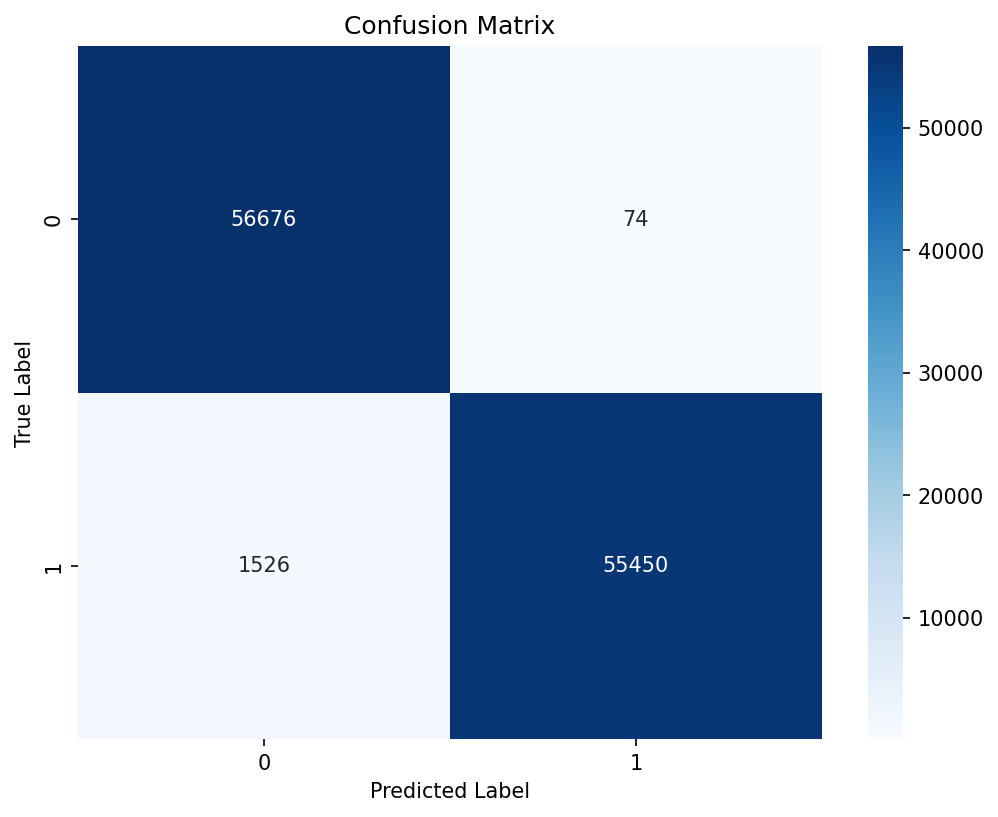
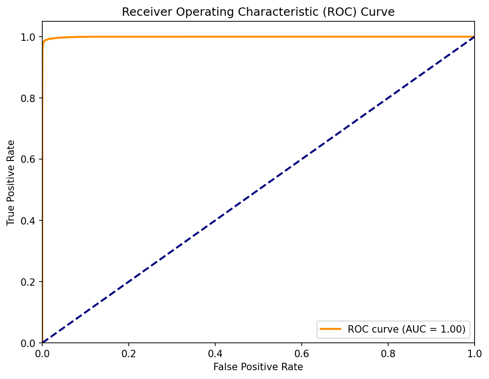
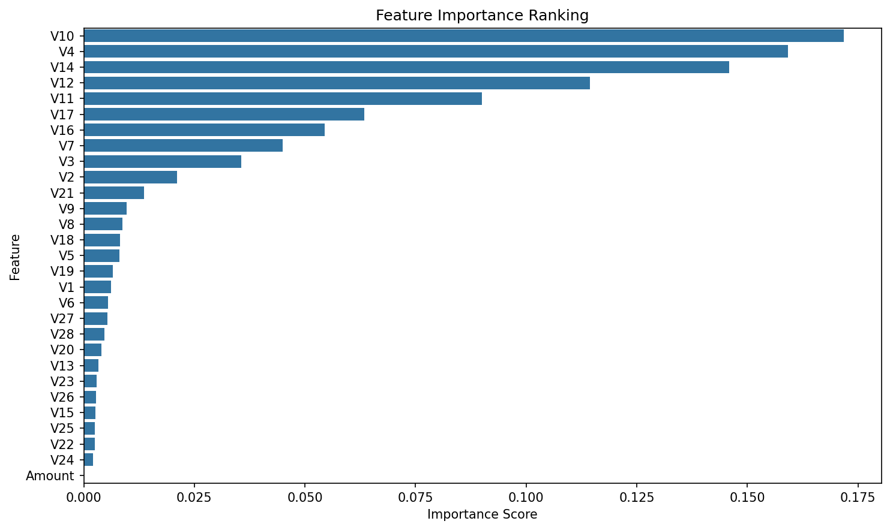
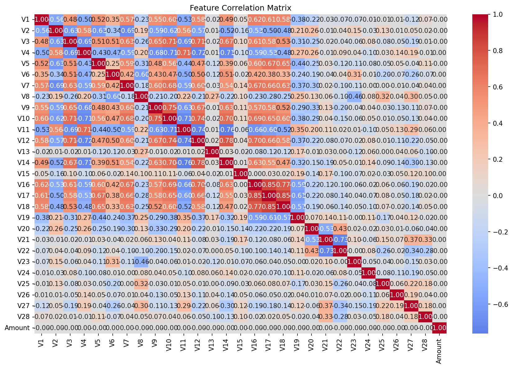

# 💳 Credit Card Fraud Detection with Random Forest (Python Project)

## 📌 Project Overview

This project builds a Random Forest model in Python to detect fraudulent credit card transactions. It trains and tests the model on 568,630 anonymized transactions from European cardholders in 2023.

The model scored very well on the test data, catching 97.3% of fraud. But this dataset is **50% fraud**, while real card fraud is closer to **0.17%** of transactions. So the project goes further than most tutorials: it estimates how the model would perform at real-world fraud rates, tunes the decision threshold, measures the fraud dollars caught and missed, and compares the model with a simpler baseline.

## 🎯 Key Features

✅ Data Inspection: Checked 568,630 rows and 31 columns for missing values and data types. 
✅ Train/Test Split: Held back 20% of transactions (113,726) to test the model on data it had not seen. 
✅ Feature Scaling: Standardized features with `StandardScaler`, fitting only on the training set. 
✅ Cross-Validation: Tested the model on 5 different splits of the training data to check that results hold up. 
✅ Random Forest Model: Trained a 100-tree classifier with `max_depth=10` and parallel processing (`n_jobs=-1`). 
✅ Model Evaluation: Measured precision, recall, F1-score, a confusion matrix, and a ROC curve with AUC. 
✅ Real-World Fraud Rate Test: Estimated precision at 50%, 1%, and 0.17% fraud rates. 
✅ Threshold Tuning: Compared frauds missed and false alarms at 5 decision thresholds. 
✅ Dollar Impact: Measured the fraud amounts caught and missed. 
✅ Baseline Comparison: Compared Random Forest with logistic regression.

## 📷 Visualizations

### Confusion Matrix

### ROC Curve

### Feature Importance

### Feature Correlation Matrix

## 🗂️ Repository Files

| File | Description |
|------|-------------|
| `credit_card_fraud_detection.ipynb` | Jupyter Notebook with the full code, model, and outputs |
| `confusion_matrix.png` | Confusion matrix of predictions on the test set |
| `roc_curve.png` | ROC curve with the AUC score |
| `feature_importance.png` | Feature importance ranking from the Random Forest |
| `correlation_heatmap.png` | Correlation matrix of the model features |

**Note:** The dataset (`creditcard_2023.csv`, about 300 MB) is not included because it is larger than GitHub's upload limit. To run the notebook, download it from the link under Dataset Source and place it in the same folder as the notebook.

## 🧹 Data Preparation

- Loaded the data with `pd.read_csv()` using a relative file path, so the notebook runs from any computer.
- Confirmed the dataset has no missing values in any of its 31 columns.
- Dropped the `id` column and set `Class` as the target (1 = fraud, 0 = legitimate).
- Used 29 features: `V1` to `V28`, which are anonymized features created to protect cardholder privacy, plus `Amount`.
- Split the data 80/20 with `random_state=42`: 454,904 training rows and 113,726 test rows.
- Scaled the features with `StandardScaler`, fitting only on the training set to avoid leaking test data into the model.

## 🛠️ Skills & Tools Applied

- Language and Environment: Python, Jupyter Notebook (Anaconda)
- Libraries: pandas, NumPy, scikit-learn, Matplotlib, Seaborn
- Models: Random Forest, logistic regression (baseline)
- Validation: 5-fold cross-validation, train/test split
- Evaluation: Precision, recall, F1-score, confusion matrix, ROC curve and AUC
- Business Analysis: Base-rate adjustment, threshold tuning, dollar impact
- Performance: Parallel training with `n_jobs=-1` on a large dataset

## 📈 Business Questions Answered

This project provides insights into:

- How accurately can a model separate fraud from legitimate transactions?
- How would the model perform at real-world fraud rates?
- What is the tradeoff between catching more fraud and flagging more legitimate customers?
- How much fraud money does the model catch and miss?
- Does a more complex model beat a simple baseline?

## 💡 Key Insights

### Model Performance

- **Cross-validation F1 averaged 0.985** across 5 folds, with scores ranging from 0.984 to 0.986. The model performed consistently on every split.
- On the 113,726 test transactions, the model reached **98.6% accuracy**, **97.3% recall**, and **99.9% precision**.
- It caught **55,450 of 56,976** frauds and raised only **74 false alarms** out of 56,750 legitimate transactions.
- The ROC curve reached an **AUC of X.XXXX**, meaning the model separated fraud from legitimate transactions almost perfectly.

### Performance at Real-World Fraud Rates

The test set is 50% fraud, which makes precision look very high. Using the model's actual catch rate and false alarm rate, this table estimates results for 100,000 transactions at different fraud rates:

| Fraud Rate | Frauds Caught | False Alarms | Precision |
|---|---|---|---|
| 50% (this dataset) | 48,661 | 65 | 99.9% |
| 1% | 973 | 129 | 88.3% |
| 0.17% (typical real world) | 165 | 130 | **56.0%** |

- At a realistic fraud rate, **precision drops from 99.9% to 56.0%**. About 130 legitimate transactions would be flagged for every 165 frauds caught.
- This is the most important finding in the project. A model's precision depends heavily on how common fraud is, so results on balanced data do not carry over directly to real use.

### Threshold Tuning

| Threshold | Frauds Missed | False Alarms | Recall | Precision |
|---|---|---|---|---|
| 0.5 (default) | 1,526 | 74 | 97.3% | 99.9% |
| 0.4 | 932 | 211 | 98.4% | 99.6% |
| 0.3 | 591 | 555 | 99.0% | 99.0% |
| 0.2 | 311 | 1,507 | 99.5% | 97.4% |
| 0.1 | 35 | 5,221 | 99.9% | 91.6% |

- The default 0.5 threshold is cautious. It misses 1,526 frauds to keep false alarms at 74.
- **A 0.3 threshold balances the two errors** (591 missed, 555 false alarms) and catches **935 more frauds** than the default.
- The best threshold depends on cost. If a missed fraud costs much more than reviewing a false alarm, a lower threshold makes sense. At real-world fraud rates, though, every extra false alarm lowers precision further.

### Dollar Impact

- The model caught **$670,950,497** in fraudulent transaction amounts and missed **$18,380,902**, catching about **97.3% of fraud dollars**.

### Baseline Comparison

| Model | Accuracy | Fraud Recall | Fraud Precision | F1 (Fraud) |
|---|---|---|---|---|
| Random Forest | 98.6% | 97.3% | 99.9% | 0.986 |
| Logistic Regression | 96.5% | 95.3% | 97.7% | 0.965 |

- Random Forest beat logistic regression on every measure. Logistic regression missed about **2,680 frauds**, compared with **1,526** for Random Forest, and raised far more false alarms.
- The baseline still scored above 95%, which shows this dataset is relatively easy to separate.

### Feature Patterns

- **V10, V4, V14, V12, and V11** were the most important features, together making up about two-thirds of the model's importance.
- **Amount had almost zero importance** and almost no correlation with any other feature. In this dataset, transaction size tells the model nothing about fraud.
- Many of the V features are strongly correlated with each other (up to ±0.85). Anonymized features like these are usually built to be uncorrelated, so this pattern likely reflects how the dataset was balanced or generated.

*Note: The dataset is balanced at 50% fraud, which is far from real-world conditions, so the real-world estimates above assume the model's catch rate and false alarm rate stay the same at lower fraud rates. The V features are anonymized, so the important features cannot be linked to real-world behaviors. The dataset does not state a currency for `Amount`; dollar signs are used for readability.*

## 🚀 Learning Outcomes

Building this project strengthened my skills in:

📌 Training and validating a Random Forest on a large dataset 
📌 Speeding up model training with parallel processing 
📌 Reading confusion matrices, ROC curves, and AUC 
📌 Understanding how the fraud rate changes precision 
📌 Tuning a decision threshold to balance missed fraud and false alarms 
📌 Translating model results into dollar impact 
📌 Comparing a complex model with a simple baseline

## 🔮 Next Steps

- Test the model on a dataset with a realistic fraud rate, such as the original 2013 European credit card dataset.
- Add a precision-recall curve, which is more informative than ROC when fraud is rare.
- Choose the threshold with a cost model that assigns a dollar cost to missed fraud and to false alarms.
- Compare Random Forest with gradient boosting models such as XGBoost or LightGBM.
- Tune the model's settings with `GridSearchCV`.

## 📚 Dataset Source

[Credit Card Fraud Detection Dataset 2023](https://www.kaggle.com/datasets/nelgiriyewithana/credit-card-fraud-detection-dataset-2023/data) by nelgiriyewithana on Kaggle.

## 🙌 Acknowledgment

This project taught me that a 99% score is the start of the analysis, not the end. Testing the model at real-world fraud rates showed that the real question is not how accurate a model is, but how it will behave when it meets the data it was built for.

## 🔗 Related Link

[LinkedIn Post](https://www.linkedin.com/feed/update/urn:li:activity:7525981441764024320/)

## 👨‍💻 Author

**Omar Shazley**: Data Analyst | Python, Excel, SQL, and healthcare data analytics

💼 [LinkedIn](https://www.linkedin.com/in/omar-shazley-914a16b1/) 
💻 [GitHub Portfolio](https://github.com/Bromar95) 
📧 Email: [omarshazley@gmail.com](mailto:omarshazley@gmail.com)

✨ If you like this project, don't forget to ⭐ star the repo!
